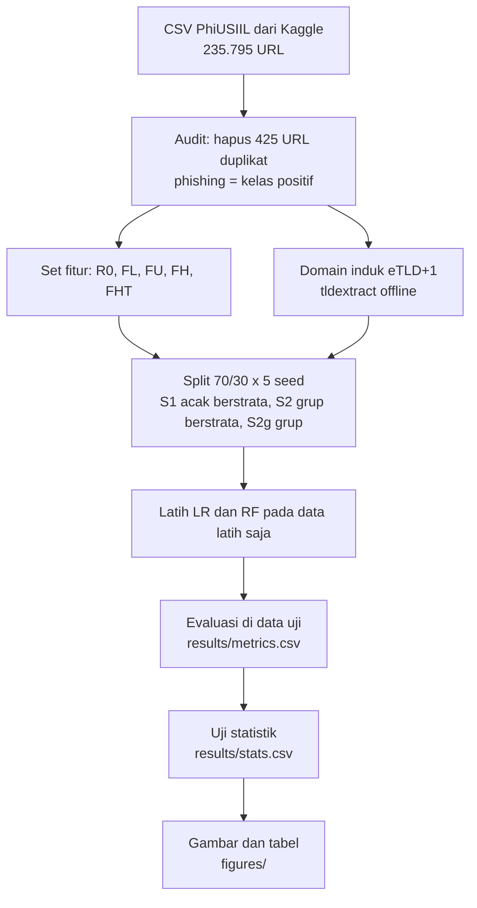

# ttki-p1-phishing-shortcut

Proyek akhir Tata Tulis Karya Ilmiah (TTKI), topik P1: deteksi URL phishing pada dataset PhiUSIIL.
Kelompok 9: Hammam Hidayatullah (3124600096) dan Dimas Reza Ardhana (3124600102), Sarjana Terapan Teknik Informatika, Politeknik Elektronika Negeri Surabaya.

Draf paper: [paper/draft.md](paper/draft.md).

## Pertanyaan penelitian

- **RQ1:** Seberapa besar kinerja deteksi phishing pada PhiUSIIL bergantung pada fitur yang mengikuti templat URL sah?
- **RQ2:** Apakah pemisahan data berdasarkan domain induk (eTLD+1) mengubah estimasi kinerja dibandingkan *stratified random split*?

Ringkasan hasil (rata-rata 5 seed, F1-score, phishing = kelas positif):

| Set fitur | S1 LR / RF | S2 LR / RF |
|---|---|---|
| R0, aturan templat tanpa ML | 99,49 | 99,51 |
| FL (F1), 50 fitur bawaan | 99,99 / 100,00 | 99,98 / 100,00 |
| FU (F2), 22 fitur URL bawaan | 99,97 / 99,99 | 99,95 / 99,99 |
| FH (F3), 10 fitur host tanpa templat | 71,78 / 75,31 | 72,36 / 73,30 |
| FHT (F4), FH + 3 penanda templat | 99,58 / 99,60 | 99,59 / 99,59 |

Angka di atas diambil dari `figures/tables.md`, yang dibuat dari `results/metrics.csv`.

## Alur eksperimen



## Nama set fitur

Paper memakai nama tampilan supaya tidak bentrok dengan metrik F1. Kode dan CSV tetap memakai kode lama.

| Kode di kode/CSV | Nama di paper | Isi |
|---|---|---|
| R0 | R0 | Aturan: sah bila URL cocok `^https://www\.[^/?#]+/?$` |
| F1 | FL | Semua 50 fitur numerik bawaan (URL dan isi halaman) |
| F2 | FU | 22 fitur URL bawaan (daftar di bawah) |
| F3 | FH | 10 fitur host yang dihitung ulang dari hostname tanpa `www.` dan port (`src/features.py`, `F3_COLUMNS`) |
| F4 | FHT | FH + `is_https`, `starts_www`, `no_path_query` |

Daftar lengkap FU (F2): `URLLength`, `DomainLength`, `IsDomainIP`, `TLDLength`, `NoOfSubDomain`, `HasObfuscation`, `NoOfObfuscatedChar`, `ObfuscationRatio`, `NoOfLettersInURL`, `LetterRatioInURL`, `NoOfDegitsInURL`, `DegitRatioInURL`, `NoOfEqualsInURL`, `NoOfQMarkInURL`, `NoOfAmpersandInURL`, `NoOfOtherSpecialCharsInURL`, `SpacialCharRatioInURL`, `IsHTTPS`, `CharContinuationRate`, `TLDLegitimateProb`, `URLCharProb`, `URLSimilarityIndex`.

## Data

CSV tidak di-commit. Unduh dari Kaggle (tautan, versi, ukuran, SHA-256, dan lisensi di [data/README.md](data/README.md)), lalu taruh di folder induk repo sebagai `../PhiUSIIL_Phishing_URL_Dataset.csv`, atau arahkan variabel lingkungan `PHIUSIIL_CSV` ke lokasi file.

## Lingkungan

- Windows 11, Python 3.14.0
- Paket utama: pandas 3.1.1, numpy 2.5.5, scikit-learn 1.9.1, scipy 1.18.1, tldextract 5.4.0, matplotlib 3.11.2 (`requirements.txt`); daftar lengkap di `environment-freeze.txt`

```bash
py -3.14 -m venv .venv
.venv\Scripts\activate          # Linux/macOS: source .venv/bin/activate
pip install -r requirements.txt
```

## Cara menjalankan

Jalankan dari folder repo, berurutan:

| Langkah | Perintah | Hasil | Waktu kira-kira |
|---|---|---|---|
| 1. Audit data | `python -m src.audit` | `results/audit.json` | 10 detik |
| 2. Baseline | `python -m src.baseline` | `results/baseline.csv` | 20 detik |
| 3. Eksperimen utama | `python -m src.run_experiments` | `results/metrics.csv`, `results/split_report.csv` | 5 menit |
| 4. Uji statistik | `python -m src.stats` | `results/stats.csv`, `results/composition_corr.csv` | beberapa detik |
| 5. Gambar dan tabel | `python -m src.make_figures` | `figures/*.png`, `figures/tables.md` | beberapa detik |
| 6. Matriks literatur | `python references/build_matrix.py` | `references/literature_matrix.csv` | instan |

Notebook `notebooks/01_audit.ipynb`, `02_baseline.ipynb`, dan `03_experiment.ipynb` menampilkan hasil yang sama. Notebook 03 hanya membaca `results/`, kecuali `RUN = True`.

`python -m src.reference_results` membaca angka repo acuan dari folder `../_reference/` (lihat bagian kredit) ke `results/baseline_reference.csv`. Folder itu tidak ikut repo, jadi langkah ini opsional.

**Seed dan split.** Seed: 7, 21, 42, 123, 2026. Rasio latih/uji 70/30.
- S1: `train_test_split(..., stratify=y)`.
- S2: `StratifiedGroupKFold(n_splits=10, shuffle=True)` dengan grup eTLD+1; 3 fold uji dipilih dengan `numpy.random.default_rng(seed)`.
- S2g: `GroupShuffleSplit(test_size=0.3)` dengan grup eTLD+1.

**Domain induk** dihitung dengan `tldextract.TLDExtract(suffix_list_urls=())`, yaitu snapshot Public Suffix List bawaan versi 5.4.0, hanya bagian ICANN. Dengan pilihan ini `x.web.app` menjadi `web.app`. Dengan PSL *private*, setiap subdomain menjadi grup sendiri dan split akan mendekati split per hostname.

Hasil metrik bersifat deterministik untuk versi paket yang sama. Kolom waktu (`train_time_s`, `infer_ms_per_1000`) bergantung pada mesin.

## Struktur repo

```
data/README.md               asal data, lisensi, hash
src/data.py                  baca CSV, hapus duplikat, balik label
src/features.py              R0, F1-F4
src/splits.py                eTLD+1, S1, S2, S2g
src/audit.py                 audit dataset
src/baseline.py              reproduksi baseline (protokol acuan dan protokol kita)
src/reference_results.py     angka repo acuan dari ../_reference/
src/run_experiments.py       120 run + R0
src/stats.py                 paired t-test, IK 95%, Wilcoxon, korelasi komposisi
src/make_figures.py          gambar dan tabel paper
notebooks/                   01_audit, 02_baseline, 03_experiment
results/                     semua angka yang dipakai paper
figures/                     gambar dan tables.md
references/                  matriks literatur
paper/                       draf paper, templat respons reviewer, kontribusi dan pernyataan
```

## Acuan dan kredit

- Protokol baseline (stratified 70/30, Logistic Regression dan Random Forest pada semua fitur numerik) mengikuti repositori [pradhyumnaag30/PhiUSIIL-Phishing-URL-Detection](https://github.com/pradhyumnaag30/PhiUSIIL-Phishing-URL-Detection) (commit `4b4d6ae`, 2025-12-04). Repositori itu tidak mencantumkan lisensi (dicek 2026-11-26), sehingga kodenya tidak disalin ke sini. Notebook `02_Baseline.ipynb` mereka dijalankan apa adanya di luar repo ini, dan protokolnya ditulis ulang di `src/baseline.py`. Perbandingan angkanya ada di `results/baseline_reference.csv` dan `results/baseline.csv`.
- `Dataset/Dataset.csv` di repositori acuan memiliki SHA-256 yang sama dengan CSV yang kami pakai (lihat `data/README.md`).
- Templat URL sah, aturan regex, dan model netral-templat pertama kali dilaporkan di repositori [mutwassim/Robustness-or-Artifact](https://github.com/mutwassim/Robustness-or-Artifact) (Mutwassim Haider, 2026). Penelitian ini mengujinya ulang secara terkendali. Tidak ada kode dari repositori itu yang dipakai.
- Dataset: Prasad (2023), Mendeley Data, DOI 10.17632/shwpxscxy2.2; paper pendamping Prasad & Chandra (2024), DOI 10.1016/j.cose.2023.103545.
- Pustaka: scikit-learn (Pedregosa dkk., 2011), pandas, NumPy, SciPy, tldextract, matplotlib, dengan versi seperti di atas.

## Riwayat desain

Desain awal: F1-F3 x S1/S2 x LR/RF x 5 seed (60 run) + aturan R0, dengan S2 = `GroupShuffleSplit` per domain induk. Setelah run pertama, dua tambahan dibuat:

1. **F4 = F3 + tiga penanda templat biner** (`is_https`, `starts_www`, `no_path_query`, dihitung dari URL). F3 hanya punya 10 fitur, sedangkan F2 punya 22. F4 dipakai untuk memeriksa apakah penurunan F3 terhadap F2 disebabkan hilangnya templat atau sekadar berkurangnya jumlah fitur. Efek `F4 - F3` dan `F4 - F2` ditambahkan ke `results/stats.csv`.
2. **S2 diganti `StratifiedGroupKFold`** (`n_splits=10`, `shuffle=True`, `random_state=seed`, grup = eTLD+1). Tiga dari sepuluh fold digabung sebagai data uji (30%). Pilihan ini dibandingkan dengan `n_splits=3` dan satu fold uji (33,3%); 10 fold dengan 3 fold uji dipilih karena porsinya tepat 30%, sama dengan S1. Alasan penggantian: pada `GroupShuffleSplit` proporsi phishing di data uji bervariasi 35,8-49,0% antar seed, dan F1 pada F3 berkorelasi sekitar 0,98 dengan proporsi itu, sehingga perbandingan S1 vs S2 tercampur efek komposisi. Pemeriksaan berikutnya menunjukkan bahwa `StratifiedGroupKFold` selalu menempatkan grup terbesar di fold-fold awal (web.app, firebaseapp.com, dan weeblysite.com selalu masuk data uji bila fold 0-2 yang diambil). Karena itu tiga fold uji dipilih acak per seed dengan `numpy.random.default_rng(seed)`.
3. Hasil `GroupShuffleSplit` tidak dibuang. Hasil itu disimpan sebagai **S2g** di `results/metrics.csv` dan `results/split_report.csv`, dan diuji di `results/stats.csv` sebagai analisis sensitivitas. Angka S1 dan S2g sama dengan run pertama (matriks konfusi identik; ROC-AUC dan PR-AUC berbeda paling besar 1e-7 karena pembulatan).
4. Nama set fitur di paper diganti menjadi FL, FU, FH, FHT (lihat bagian Nama set fitur). Kode dan CSV tidak berubah.

Total run sekarang: 4 set fitur x 3 split x 2 model x 5 seed = 120 run, ditambah R0 untuk setiap split dan seed.

## Riwayat revisi RQ

Proposal awal kelompok memakai RQ dari buku petunjuk (Bab 3.1): pengaruh fitur URL-only dan *domain-grouped split* terhadap F1, ROC-AUC, dan waktu inferensi. Audit data kemudian menemukan bahwa semua URL sah di PhiUSIIL mengikuti satu templat (https, diawali `www.`, tanpa path, `URLSimilarityIndex = 100`), dan bahwa split per hostname hampir sama dengan *random split* karena hampir setiap hostname hanya muncul sekali. RQ lalu direvisi menjadi RQ1 dan RQ2 di atas, sesuai buku petunjuk Bab 4.2 no. 7 (revisi RQ bila temuan awal mengubah persoalan).

## Lisensi

Kode di repositori ini berlisensi MIT (lihat `LICENSE`). Dataset tidak disertakan dan mengikuti lisensinya sendiri: CC BY-SA 4.0 di Kaggle, CC BY 4.0 di Mendeley Data.
