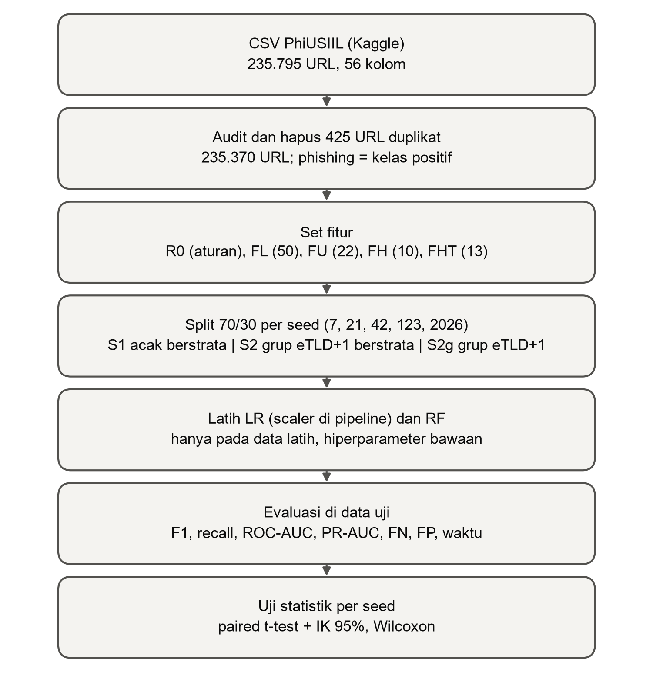
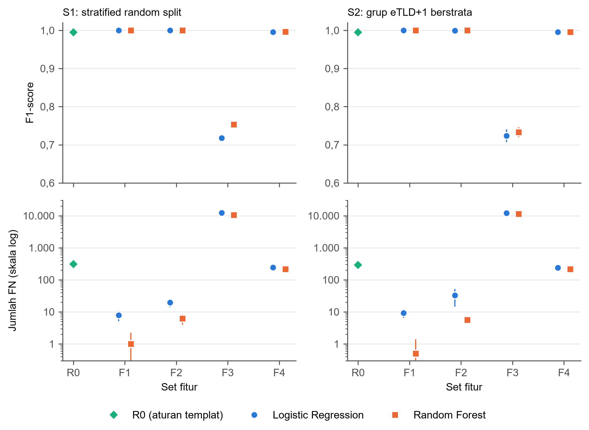

# Ketergantungan Model Deteksi URL Phishing pada Artefak Dataset: Evaluasi Fitur Berbasis Host dan Validasi Berbasis Domain Induk pada PhiUSIIL

# Dataset Artifacts in Phishing URL Detection: Evaluating Host-Based Features and Registered-Domain Validation on PhiUSIIL

**Hammam Hidayatullah¹, Dimas Reza Ardhana²**

¹ ² Program Studi Sarjana Terapan Teknik Informatika, Politeknik Elektronika Negeri Surabaya

Email: ¹hammamfais7@gmail.com, ²

Kelompok XX, Tata Tulis Karya Ilmiah, Topik P1

---

## Abstrak

Model deteksi URL phishing pada dataset PhiUSIIL umumnya melaporkan skor hampir sempurna. Audit kami menemukan bahwa seluruh 134.850 URL sah pada dataset ini mengikuti satu templat: skema https, host diawali `www.`, dan tanpa path. Pola ini hanya muncul pada 1,03% URL phishing. Pola templat ini sebelumnya sudah dilaporkan di sebuah repositori publik dengan satu model dan satu split. Penelitian ini mengujinya secara terkendali. Kami membandingkan aturan templat tanpa pembelajaran mesin (R0) dengan empat set fitur: semua fitur bawaan (F1), fitur URL bawaan (F2), fitur host yang dihitung ulang tanpa templat (F3), dan F3 ditambah tiga penanda templat (F4). Setiap set diuji dengan Logistic Regression dan Random Forest pada *stratified random split* dan pada split berstrata yang memisahkan domain induk (eTLD+1), masing-masing dengan lima *seed*. Aturan R0 saja mencapai F1 99,49%. Tanpa templat, F1 turun 24,68–28,19 poin persentase (pp) dibandingkan F2 (*paired t-test*, p < 0,0001). Menambahkan tiga penanda templat mengembalikan F1 ke 99,58–99,60%, hanya 0,36–0,40 pp di bawah F2 yang memakai 22 fitur. Pemisahan per domain induk tidak mengubah F1 pada F1, F2, dan F4. Penurunan kecil hanya terlihat pada F3 dengan Random Forest (−2,02 pp; p = 0,022). Hasil ini mengindikasikan bahwa skor tinggi pada PhiUSIIL sebagian besar berasal dari artefak cara data dikumpulkan, bukan dari pola phishing yang dapat digeneralisasi.

**Kata kunci:** artefak dataset, deteksi URL phishing, kebocoran data, PhiUSIIL, *shortcut learning*, validasi berbasis domain

## Abstract

Phishing URL detectors evaluated on the PhiUSIIL dataset usually report near-perfect scores. Our audit found that all 134,850 legitimate URLs in this dataset share one template: the https scheme, a host that begins with `www.`, and no path. Only 1.03% of phishing URLs match it. This template pattern was previously reported in a public repository using one model and one split. This study tests it under controlled conditions. We compare a template rule without machine learning (R0) with four feature sets: all built-in features (F1), built-in URL features (F2), host features recomputed without the template (F3), and F3 plus three template flags (F4). Each set is evaluated with Logistic Regression and Random Forest under a stratified random split and under a stratified split that separates registered domains (eTLD+1), each over five seeds. The R0 rule alone reaches an F1-score of 99.49%. Without the template, F1 drops by 24.68–28.19 percentage points (pp) relative to F2 (paired t-test, p < 0.0001). Adding the three template flags restores F1 to 99.58–99.60%, only 0.36–0.40 pp below F2 with 22 features. Registered-domain splitting does not change F1 for F1, F2, and F4. A small drop appears only for F3 with Random Forest (−2.02 pp; p = 0.022). These results indicate that high scores on PhiUSIIL largely reflect an artifact of how the data were collected rather than generalizable phishing patterns.

**Keywords:** data leakage, dataset artifacts, domain-aware validation, phishing URL detection, PhiUSIIL, shortcut learning

---

## 1. Pendahuluan

Klasifikasi URL berbasis pembelajaran mesin banyak dipakai untuk melengkapi daftar hitam (*blacklist*), karena daftar hitam hanya mengenali alamat yang sudah dilaporkan. Ma dkk. (2009) menunjukkan bahwa URL berbahaya dapat dikenali dari fitur leksikal dan fitur host tanpa membuka halamannya. Sahingoz dkk. (2019) juga membangun deteksi phishing yang hanya memakai URL. Pendekatan ini menarik karena prediksi dapat dibuat sebelum pengguna mengklik tautan.

PhiUSIIL (Prasad & Chandra, 2024a; Prasad, 2023) adalah salah satu dataset terbesar untuk tugas ini. Dokumentasinya menyebut 134.850 URL sah dan 100.945 URL phishing, dengan fitur yang diekstraksi dari URL dan kode sumber halaman (Prasad & Chandra, 2024b). Skor pada dataset ini sangat tinggi. Repositori acuan yang ditunjuk buku petunjuk mata kuliah melaporkan F1 1,0000 untuk Random Forest dengan *stratified random split* (pradhyumnaag30, 2025). Ahamed dkk. (2026) memakai split per host 70/15/15 dan tetap memperoleh akurasi uji 0,9962–0,9984 untuk empat model, dari Logistic Regression sampai BERT.

Skor setinggi itu perlu diperiksa. Arp dkk. (2022) mencatat dua jebakan yang relevan: *sampling bias*, ketika data tidak mewakili distribusi masalah yang sebenarnya, dan *spurious correlations*, ketika artefak yang tidak terkait masalah keamanan menjadi jalan pintas untuk memisahkan kelas. Geirhos dkk. (2020) menyebut jalan pintas seperti ini sebagai *shortcut*, yaitu aturan keputusan yang bekerja pada *benchmark* tetapi gagal pada kondisi uji yang lebih sulit. Kebocoran data terjadi ketika model memperoleh informasi tentang target yang seharusnya tidak tersedia secara sah (Kaufman dkk., 2011). Kapoor dan Narayanan (2023) memasukkan fitur yang menjadi proksi hasil (L2) dan ketidakbebasan antara sampel latih dan uji (L3.2) ke dalam taksonomi kebocoran data. Pada PhiUSIIL, Ahamed dkk. (2026) mengakui bahwa pemisahan per host tidak menjamin pemisahan per domain induk; ada 1.387 domain induk yang sama di data latih dan data uji mereka. Haider (2026), dalam repositori yang masih berstatus *work in progress*, melaporkan bahwa semua URL sah di PhiUSIIL berbentuk `https://www.domain.tld` tanpa path. Repositori itu juga melaporkan bahwa aturan regex sederhana mencapai akurasi 0,9958 dan model netral-templat mencapai akurasi 0,8647. Hasil tersebut berasal dari satu split per host, tanpa pengulangan dan tanpa uji statistik. Mia dkk. (2024) dan Yi dkk. (2026) menguji perpindahan antardataset, tetapi tidak memakai PhiUSIIL.

Penelitian ini adalah replikasi kritis yang menguji temuan templat tersebut secara terkendali. Pertanyaan penelitiannya adalah: (RQ1) seberapa besar kinerja deteksi pada PhiUSIIL bergantung pada fitur yang mengikuti templat URL sah, dan (RQ2) apakah pemisahan data per domain induk (eTLD+1) mengubah estimasi kinerja dibandingkan *stratified random split*. Hipotesis kami adalah H1: kinerja turun jelas ketika model hanya memakai fitur host yang tidak membawa templat, dan H2: split per domain induk menurunkan kinerja, terutama pada fitur host tersebut. Kontribusi penelitian ini adalah:

1. pengujian dua model pada lima *seed* dengan uji statistik berpasangan, bukan satu model pada satu split;
2. ablasi F4 yang menambahkan tiga penanda templat ke fitur host, untuk memisahkan efek templat dari efek jumlah fitur;
3. split berstrata berbasis domain induk (eTLD+1), yang lebih ketat daripada pemisahan per host pada studi sebelumnya;
4. analisis komposisi data uji pada split berbasis grup, yang menunjukkan pengaruh kelompok domain *hosting* besar terhadap estimasi kinerja.

## 2. Metode

Gambar 1 merangkum alur eksperimen. Semua angka pada bagian Hasil berasal dari berkas di folder `results/` pada repositori penelitian.

**Gambar 1.** Alur eksperimen, dari audit data sampai uji statistik.

### 2.1 Dataset dan audit

Sumber data adalah dataset Kaggle versi 1 (KagglePro, 2024) dengan lisensi CC BY-SA 4.0. Dataset aslinya diterbitkan di Mendeley Data dengan lisensi CC BY 4.0 (Prasad, 2023). Berkas `PhiUSIIL_Phishing_URL_Dataset.csv` yang kami pakai berukuran 56.854.345 byte, sama dengan ukuran berkas di Kaggle. Hash SHA-256-nya sama dengan berkas `Dataset.csv` pada repositori acuan. Audit menemukan 235.795 baris, 56 kolom, tanpa nilai kosong, tanpa nilai tak hingga, dan tanpa baris yang duplikat penuh (Tabel 1). Ada 425 URL yang masing-masing muncul dua kali; semuanya berlabel phishing dan tidak ada konflik label. Kolom `FILENAME` membocorkan label, karena 36.286 baris yang namanya berawalan `mw` seluruhnya phishing.

**Tabel 1.** Karakteristik dataset

| Butir | Nilai |
|---|---|
| Baris pada CSV asli | 235.795 |
| Label asli: sah (1) / phishing (0) | 134.850 / 100.945 |
| URL duplikat yang dihapus (semuanya phishing) | 425 |
| Baris setelah penghapusan duplikat: sah / phishing | 134.850 / 100.520 |
| Fitur numerik bawaan | 50 |
| Hostname unik | 220.086 |
| Domain induk (eTLD+1) unik | 175.513 |
| Domain induk yang muncul lebih dari sekali / jumlah barisnya | 6.012 / 66.294 |
| Domain induk dengan label campuran | 120 |

### 2.2 Prapemrosesan

Duplikat URL dihapus sebelum data dibagi, sehingga tersisa 235.370 URL. Label dibalik sehingga phishing menjadi kelas positif (1). Kolom `FILENAME`, `URL`, `Domain`, `TLD`, dan `Title` tidak dipakai sebagai fitur. Kolom `URL` dan `Domain` hanya dipakai untuk menghitung fitur F3, penanda templat F4, dan grup split. Standardisasi untuk Logistic Regression dilakukan di dalam `Pipeline`, sehingga parameternya hanya dipelajari dari data latih. Penelitian ini tidak melakukan penyetelan hiperparameter, sehingga tidak ada set validasi. Seluruh data di luar data latih dipakai sekali sebagai data uji.

### 2.3 Set fitur

Lima konfigurasi dibandingkan (Tabel 2).

**Tabel 2.** Set fitur

| Kode | Isi | Jumlah fitur |
|---|---|---|
| R0 | Aturan tanpa pelatihan: URL diprediksi sah bila cocok dengan `^https://www\.[^/?#]+/?$`, selain itu phishing | 0 |
| F1 | Semua fitur numerik bawaan (fitur URL dan fitur isi halaman) | 50 |
| F2 | Fitur URL bawaan: `URLLength`, `DomainLength`, `IsDomainIP`, `TLDLength`, `NoOfSubDomain`, `HasObfuscation`, `NoOfObfuscatedChar`, `ObfuscationRatio`, `NoOfLettersInURL`, `LetterRatioInURL`, `NoOfDegitsInURL`, `DegitRatioInURL`, `NoOfEqualsInURL`, `NoOfQMarkInURL`, `NoOfAmpersandInURL`, `NoOfOtherSpecialCharsInURL`, `SpacialCharRatioInURL`, `IsHTTPS`, `CharContinuationRate`, `TLDLegitimateProb`, `URLCharProb`, `URLSimilarityIndex` | 22 |
| F3 | Fitur host yang kami hitung ulang dari hostname setelah awalan `www.` dan nomor port dibuang: panjang host, jumlah label, jumlah dan rasio angka, jumlah tanda hubung, jumlah huruf, panjang label terpanjang, panjang suffix publik, penanda alamat IP, dan entropi karakter Shannon | 10 |
| F4 | F3 ditambah tiga penanda templat biner dari URL: `is_https`, `starts_www`, `no_path_query` | 13 |

F2 sengaja tetap memuat `URLSimilarityIndex`, `TLDLegitimateProb`, dan `URLCharProb`. Ketiganya tidak memerlukan isi halaman, sehingga tergolong fitur URL bawaan. Pertanyaan penelitian ini adalah seberapa jauh fitur bawaan seperti ini membawa templat. Karena itu fitur tersebut tidak dibuang di F2, dan F3 serta F4 dipakai sebagai kontrolnya. F3 tidak dapat melihat skema, awalan `www.`, path, maupun query. F4 hanya menambahkan informasi templat itu kembali. Kalau F4 mendekati F2 sementara F3 jauh di bawahnya, maka penurunan F3 tidak disebabkan oleh jumlah fitur yang lebih sedikit.

### 2.4 Strategi split

Ketiga strategi memakai rasio 70/30 dan lima *seed*: 7, 21, 42, 123, dan 2026.

- **S1**: *stratified random split*, sama dengan protokol repositori acuan.
- **S2**: `StratifiedGroupKFold` dengan 10 fold, `shuffle=True`, dan grup berupa domain induk. Tiga fold dipilih acak per *seed* sebagai data uji (30%). Kami memilih acak karena algoritma ini selalu menaruh grup terbesar di fold-fold awal. Kalau fold 0–2 yang selalu diambil, tiga grup terbesar akan selalu berada di data uji pada semua *seed*.
- **S2g**: `GroupShuffleSplit` dengan grup yang sama. Split ini adalah rancangan awal S2. Proporsi phishing di data ujinya tidak dijaga, sehingga split ini kami pakai sebagai analisis sensitivitas.

Domain induk dihitung dengan `tldextract` 5.4.0 dari kolom `Domain` setelah nomor port dibuang. Pustaka dijalankan secara luring dengan salinan *Public Suffix List* bawaannya, dan hanya bagian ICANN yang dipakai. Dengan pilihan ini, `a.web.app` dan `b.web.app` masuk ke grup yang sama, yaitu `web.app`. Bila bagian *private* dari daftar itu dipakai, setiap subdomain `web.app` menjadi grup sendiri. Akibatnya split akan kembali mendekati pemisahan per hostname, yang menurut audit kami hampir sama dengan *random split* (220.086 hostname unik dari 235.795 URL). Pada S1, 3.491–3.548 domain induk muncul di data latih dan data uji sekaligus. Pada S2 dan S2g jumlahnya 0 untuk setiap *seed*.

### 2.5 Model

Logistic Regression memakai `StandardScaler` dan `LogisticRegression(max_iter=1000)`. Random Forest (Breiman, 2001) memakai `RandomForestClassifier(n_estimators=100)`. Hiperparameter lain memakai nilai bawaan scikit-learn, dengan `random_state` sama dengan *seed*. Dengan 4 set fitur, 3 split, 2 model, dan 5 *seed*, terdapat 120 run. Aturan R0 dievaluasi pada data uji yang sama untuk setiap split dan *seed*.

### 2.6 Metrik dan uji statistik

Phishing menjadi kelas positif. Kami melaporkan precision, recall, F1, ROC-AUC, PR-AUC (*average precision*), jumlah *false negative* (FN, phishing yang lolos) dan *false positive* (FP), waktu latih, serta waktu inferensi per 1.000 URL. Waktu inferensi hanya mencakup `predict_proba`, tidak termasuk ekstraksi fitur.

Setiap efek dihitung per *seed* sebagai selisih F1 dalam poin persentase (pp). Selisih diuji dengan *paired t-test* dua sisi dan dilaporkan bersama interval kepercayaan (IK) 95%. Uji Wilcoxon *signed-rank* dipakai sebagai pembanding. Dengan n = 5, nilai p dua sisi terkecil yang mungkin pada uji Wilcoxon adalah 0,0625. Selisih ROC-AUC juga diuji sebagai pembanding yang tidak bergantung pada proporsi kelas di data uji. Hasilnya ada di `results/stats.csv`.

### 2.7 Lingkungan dan reproduksi baseline

Eksperimen dijalankan pada Windows 11 dengan Python 3.14.0, pandas 3.1.1, NumPy 2.5.5, scikit-learn 1.9.1 (Pedregosa dkk., 2011), SciPy 1.18.1, tldextract 5.4.0, dan matplotlib 3.11.2. Protokol baseline mengikuti repositori pradhyumnaag30 (2025), commit `4b4d6ae`. Repositori itu tidak berlisensi, sehingga kodenya tidak kami salin. Notebook `02_Baseline.ipynb` mereka kami jalankan apa adanya di luar repositori kami. Protokolnya lalu kami tulis ulang, yaitu label sah sebagai kelas positif, tanpa penghapusan duplikat, Logistic Regression tanpa standardisasi, dan Random Forest 200 pohon.

## 3. Hasil

### 3.1 Templat URL sah

Tabel 3 menunjukkan bahwa seluruh 134.850 URL sah memakai https, diawali `www.`, tidak memiliki path, query, maupun fragmen, dan memiliki `URLSimilarityIndex` = 100. Pada URL phishing, proporsinya berturut-turut 48,74%, 41,36%, 71,60%, dan 0,78%. Hanya 1.038 URL phishing (1,03%) yang cocok persis dengan aturan R0. Dari semua fitur bawaan, ROC-AUC satu fitur tertinggi dicapai oleh `URLSimilarityIndex` (0,9961), lalu `LineOfCode` (0,9903) dan `NoOfExternalRef` (0,9880), setelah arah fitur disesuaikan.

**Tabel 3.** Ciri templat URL per label (CSV asli)

| Ciri | Sah (n = 134.850) | Phishing (n = 100.945) |
|---|---|---|
| Skema https | 134.850 (100,00%) | 49.196 (48,74%) |
| Host diawali `www.` | 134.850 (100,00%) | 41.746 (41,36%) |
| Tanpa path, query, fragmen | 134.850 (100,00%) | 72.272 (71,60%) |
| `URLSimilarityIndex` = 100 | 134.850 (100,00%) | 786 (0,78%) |
| Cocok persis dengan aturan R0 | 134.850 (100,00%) | 1.038 (1,03%) |

### 3.2 Reproduksi baseline

Dengan protokol repositori acuan dan *seed* 42, kode kami menghasilkan F1 0,999913 untuk Logistic Regression dan 1,000000 untuk Random Forest. Angka ini sama dengan README repositori tersebut. Notebook asli yang dijalankan ulang memberi 0,999913 dan 0,999988; selisih pada Random Forest kemungkinan muncul karena model mereka tidak memakai `random_state`. Dengan protokol kami pada S1 dan *seed* yang sama, F1 menjadi 0,999834 (LR) dan 0,999967 (RF).

### 3.3 Kinerja per skenario

Tabel 4 dan Gambar 2 merangkum kinerja pada S1 dan S2. Aturan R0 mencapai F1 99,49% pada S1 dan 99,51% pada S2, tanpa FP. F1 pada F1 dan F2 berada di 99,95–100,00%. Pada F3, F1 turun menjadi 71,78% (LR) dan 75,31% (RF) di S1. Penurunan ini terutama berasal dari recall, yaitu 59,25% (LR) dan 64,93% (RF). Rata-rata FN pada F3 adalah 10.576–12.288 per run, dibandingkan 1–19 pada F1 dan F2. F4 mengembalikan F1 menjadi 99,58–99,60% dengan 215–242 FN.

**Tabel 4.** Kinerja rata-rata ± simpangan baku pada 5 *seed* (F1, recall, dan ROC-AUC dalam %)

| Split | Fitur | Model | F1 | Recall | ROC-AUC | FN | FP |
|---|---|---|---|---|---|---|---|
| S1 | R0 | aturan | 99,49 ± 0,01 | 98,98 ± 0,02 | 99,49 ± 0,01 | 307,6 ± 6,0 | 0,0 ± 0,0 |
| S1 | F1 | LR | 99,99 ± 0,00 | 99,97 ± 0,01 | 100,00 ± 0,00 | 7,8 ± 2,7 | 0,0 ± 0,0 |
| S1 | F1 | RF | 100,00 ± 0,00 | 100,00 ± 0,00 | 100,00 ± 0,00 | 1,0 ± 1,2 | 0,0 ± 0,0 |
| S1 | F2 | LR | 99,97 ± 0,01 | 99,94 ± 0,02 | 99,99 ± 0,00 | 19,4 ± 5,3 | 0,0 ± 0,0 |
| S1 | F2 | RF | 99,99 ± 0,00 | 99,98 ± 0,01 | 99,99 ± 0,00 | 6,2 ± 2,2 | 0,4 ± 0,5 |
| S1 | F3 | LR | 71,78 ± 0,09 | 59,25 ± 0,07 | 82,34 ± 0,12 | 12.287,8 ± 21,4 | 1.762,4 ± 38,6 |
| S1 | F3 | RF | 75,31 ± 0,18 | 64,93 ± 0,22 | 84,92 ± 0,13 | 10.576,0 ± 66,3 | 2.260,8 ± 25,1 |
| S1 | F4 | LR | 99,58 ± 0,02 | 99,20 ± 0,04 | 99,76 ± 0,02 | 241,6 ± 12,8 | 10,8 ± 4,1 |
| S1 | F4 | RF | 99,60 ± 0,01 | 99,29 ± 0,04 | 99,71 ± 0,02 | 215,4 ± 11,3 | 26,8 ± 3,6 |
| S2 | R0 | aturan | 99,51 ± 0,06 | 99,03 ± 0,12 | 99,51 ± 0,06 | 292,6 ± 36,1 | 0,0 ± 0,0 |
| S2 | F1 | LR | 99,98 ± 0,00 | 99,97 ± 0,01 | 100,00 ± 0,00 | 9,2 ± 2,8 | 0,0 ± 0,0 |
| S2 | F1 | RF | 100,00 ± 0,00 | 100,00 ± 0,00 | 100,00 ± 0,00 | 0,4 ± 0,9 | 0,0 ± 0,0 |
| S2 | F2 | LR | 99,95 ± 0,03 | 99,89 ± 0,06 | 99,99 ± 0,01 | 33,0 ± 18,4 | 0,0 ± 0,0 |
| S2 | F2 | RF | 99,99 ± 0,00 | 99,98 ± 0,00 | 99,99 ± 0,00 | 5,6 ± 0,5 | 0,8 ± 0,8 |
| S2 | F3 | LR | 72,36 ± 1,66 | 59,95 ± 2,17 | 82,54 ± 0,97 | 12.077,0 ± 653,7 | 1.722,8 ± 28,3 |
| S2 | F3 | RF | 73,30 ± 1,30 | 62,17 ± 1,82 | 83,96 ± 0,57 | 11.406,6 ± 548,2 | 2.246,6 ± 80,6 |
| S2 | F4 | LR | 99,59 ± 0,05 | 99,22 ± 0,11 | 99,76 ± 0,04 | 235,8 ± 33,0 | 12,0 ± 3,2 |
| S2 | F4 | RF | 99,59 ± 0,05 | 99,28 ± 0,10 | 99,71 ± 0,04 | 216,0 ± 29,6 | 28,8 ± 3,3 |

Data uji berisi 70.611 URL pada setiap run S1 dan S2. Hasil lengkap, termasuk precision dan PR-AUC, ada di `figures/tables.md`.

**Gambar 2.** F1 (atas) dan jumlah FN dalam skala log (bawah) per set fitur, untuk S1 (kiri) dan S2 (kanan). Titik menunjukkan rata-rata lima *seed* dan garis menunjukkan ±1 simpangan baku. FN bernilai 0 digambar pada 0,5.

### 3.4 Efek set fitur

Tabel 5 memuat selisih F1 per *seed*. F3 lebih rendah daripada F2 sebesar 28,19 pp (LR) dan 24,68 pp (RF) pada S1, serta 27,59 pp dan 26,69 pp pada S2 (semua p < 0,0001). F4 lebih tinggi daripada F3 sebesar 24,28–27,80 pp pada kedua split. Selisih F4 terhadap F2 berada di −0,36 sampai −0,40 pp. Selisih F2 terhadap F1 berada di −0,01 sampai −0,04 pp. Pada semua perbandingan antar set fitur, kelima *seed* bertanda sama, sehingga uji Wilcoxon memberi p = 0,0625.

**Tabel 5.** Selisih F1 per *seed* dalam poin persentase (rata-rata dan IK 95%)

| Efek | Model | S1 | p (S1) | S2 | p (S2) |
|---|---|---|---|---|---|
| F3 − F2 | LR | −28,19 [−28,30; −28,08] | < 0,0001 | −27,59 [−29,61; −25,56] | < 0,0001 |
| F3 − F2 | RF | −24,68 [−24,90; −24,46] | < 0,0001 | −26,69 [−28,31; −25,07] | < 0,0001 |
| F4 − F3 | LR | 27,80 [27,67; 27,93] | < 0,0001 | 27,23 [25,22; 29,23] | < 0,0001 |
| F4 − F3 | RF | 24,28 [24,06; 24,50] | < 0,0001 | 26,30 [24,72; 27,87] | < 0,0001 |
| F4 − F2 | LR | −0,39 [−0,42; −0,36] | < 0,0001 | −0,36 [−0,41; −0,31] | < 0,0001 |
| F4 − F2 | RF | −0,39 [−0,41; −0,37] | < 0,0001 | −0,40 [−0,46; −0,34] | < 0,0001 |
| F2 − F1 | LR | −0,02 [−0,03; −0,01] | 0,0058 | −0,040 [−0,076; −0,003] | 0,0392 |
| F2 − F1 | RF | −0,01 [−0,01; −0,01] | 0,0030 | −0,01 [−0,01; −0,01] | 0,0007 |

### 3.5 Efek strategi split

Selisih S2 − S1 pada F1, F2, dan F4 berada di antara −0,02 dan 0,01 pp dengan p = 0,14–0,83. Pada F3, selisihnya adalah 0,58 pp untuk LR (IK 95% [−1,47; 2,63]; p = 0,48) dan −2,02 pp untuk RF (IK 95% [−3,55; −0,48]; p = 0,022). Kelima *seed* RF bernilai negatif (Wilcoxon p = 0,0625). Selisih ROC-AUC memberi arah yang sama: 0,20 pp untuk LR (p = 0,65) dan −0,96 pp untuk RF (IK 95% [−1,70; −0,21]; p = 0,023).

### 3.6 Analisis sensitivitas: S2g dan komposisi data uji

Pada S2g, porsi data uji berkisar 26,8–33,5% dan proporsi phishing di data uji 35,77–49,02%, sedangkan S1 dan S2 selalu 30,0% dan 42,71%. F1 pada F3 di S2g memiliki simpangan baku 8,03 pp (LR) dan 7,08 pp (RF), dibandingkan 1,66 dan 1,30 pp di S2. Selisih S2g − S1 pada F3 adalah −1,16 pp (LR; p = 0,76) dan −3,71 pp (RF; p = 0,30). Gambar 3 menunjukkan F1 pada F3 terhadap proporsi phishing di data uji. Pada S2g, korelasi keduanya adalah r = 0,98 untuk LR dan RF (n = 5; `results/composition_corr.csv`). Pada *seed* 42 dan 2026, hanya satu dari sepuluh domain induk terbesar yang masuk data uji (928 dan 1.187 baris), dan F1 pada F3 adalah 60,74–65,37%. Pada *seed* 123, lima domain tersebut masuk data uji (17.318 baris) dan F1 mencapai 78,18% (LR) dan 78,50% (RF). Pada S2, ketika proporsi kelas sudah sama, F1 pada F3 tetap berkorelasi dengan jumlah baris dari sepuluh domain terbesar di data uji (r = 0,97 untuk LR; r = 0,9995 untuk RF; n = 5).

**Gambar 3.** F1 pada F3 terhadap proporsi phishing di data uji untuk S2g (penanda penuh) dan S2 (penanda kosong). Setiap titik adalah satu *seed*.

### 3.7 Waktu komputasi

Pada S1, Logistic Regression dilatih dalam 0,27 detik dengan F1 dan 0,15 detik dengan F3. Random Forest membutuhkan 1,05 detik dan 0,79 detik. Waktu inferensi per 1.000 URL berada di 0,10–1,00 milidetik untuk semua model. Aturan R0 membutuhkan 0,37 milidetik per 1.000 URL.

## 4. Pembahasan

### 4.1 Templat sebagai jalan pintas

Hasil RQ1 mendukung H1. Aturan satu baris tanpa pembelajaran mesin sudah mencapai F1 99,49%, sehingga sebagian besar pemisahan kelas pada PhiUSIIL dapat dicapai hanya dengan membaca bentuk URL. Ketika skema, awalan `www.`, dan path disembunyikan (F3), F1 turun sekitar 25–28 pp. Ketika tiga penanda itu dikembalikan (F4), F1 naik lagi menjadi 99,6%, hanya 0,36–0,40 pp di bawah F2 yang memakai 22 fitur. Jadi penurunan pada F3 tidak dapat dijelaskan oleh jumlah fitur yang lebih sedikit. Pola ini sesuai dengan definisi *spurious correlation* dari Arp dkk. (2022): artefak yang tidak terkait masalah keamanan menjadi jalan pintas untuk memisahkan kelas. Menurut taksonomi Kapoor dan Narayanan (2023), fitur seperti `URLSimilarityIndex` yang bernilai 100 pada semua URL sah bekerja sebagai proksi label (L2).

Asal templat ini belum dapat kami pastikan. Dokumentasi publik dataset di UCI Machine Learning Repository (Prasad & Chandra, 2024b) hanya menyebut jumlah URL dan bahwa fitur diekstraksi dari URL dan kode sumber halaman. Dokumentasi itu tidak menjelaskan cara URL sah dikumpulkan. Dugaan kami, URL sah diambil dari daftar domain populer dan dibentuk ulang menjadi alamat halaman depan, sedangkan URL phishing diambil apa adanya dari laporan phishing. Dugaan ini sejalan dengan *sampling bias* (Arp dkk., 2022), tetapi belum dibuktikan oleh penelitian ini.

### 4.2 Perbandingan dengan studi sebelumnya

Temuan templat dan aturan regex sudah dilaporkan lebih dulu oleh Haider (2026). Repositori itu melaporkan akurasi 0,9958 untuk aturan regex dan 0,8647 untuk model netral-templat, dari satu split per host. Hasil kami konsisten dengan arah temuan tersebut dan menambah tiga hal: pengulangan pada dua model dan lima *seed* dengan IK 95%, ablasi F4 yang memisahkan efek templat dari jumlah fitur, serta split per domain induk. Ahamed dkk. (2026) memperoleh akurasi 0,9962–0,9984 dengan split per host. Angka itu kemungkinan juga dipengaruhi oleh templat, karena split per host tidak menyentuh bentuk URL. Kami tidak menguji model mereka secara langsung, sehingga dugaan ini perlu diperiksa dengan mengulang protokol mereka tanpa informasi templat. Mia dkk. (2024) menemukan akurasi turun ke 51% ketika model dilatih dan diuji pada dataset berbeda. Temuan kami memberi satu penjelasan yang mungkin untuk gejala seperti itu: pola yang dipelajari bisa jadi melekat pada cara satu dataset disusun.

### 4.3 Validasi per domain induk

Hasil RQ2 hanya mendukung H2 sebagian. Pada F1, F2, dan F4, split per domain induk tidak mengubah F1. Hal ini wajar, karena templat tetap tersedia di data uji, apa pun cara datanya dibagi. Penurunan 2,02 pp hanya muncul pada F3 dengan Random Forest, ketika model harus bergantung pada ciri host. Penurunan ini kemungkinan berasal dari hilangnya grup domain yang sama di data latih dan data uji (3.491–3.548 domain induk pada S1). Pada Logistic Regression, penurunan itu tidak terlihat. Penjelasan yang mungkin adalah bahwa model linear dengan 10 fitur host tidak cukup lentur untuk menghafal ciri grup domain tertentu, meskipun analisis ini tidak membuktikannya.

Hasil S2g menunjukkan bahwa split berbasis grup tanpa stratifikasi dapat menghasilkan estimasi yang sangat bervariasi. Pada dataset ini, sepuluh domain induk terbesar, seperti `web.app`, `firebaseapp.com`, dan `repl.co`, seluruhnya berisi phishing. Satu grup berisi ribuan URL. Penempatan beberapa grup besar itu menentukan komposisi data uji dan, pada F3, sebagian besar nilai F1. Korelasi yang tetap tinggi pada S2 mengindikasikan bahwa jenis grup yang masuk data uji ikut berpengaruh, bukan hanya proporsi kelasnya. Analisis ini hanya berdasarkan lima *seed*, sehingga koefisien korelasinya kurang stabil. Bagi penelitian lain yang memakai split per domain pada PhiUSIIL, temuan ini menyarankan penggunaan stratifikasi dan pelaporan komposisi data uji per *seed*.

### 4.4 Implikasi

Skor F1 di atas 99% pada PhiUSIIL tidak cukup untuk menilai kemampuan model mendeteksi phishing pada URL baru. Dalam penggunaan nyata, URL sah juga memiliki path, query, dan subdomain selain `www.`. Model yang bergantung pada templat kemungkinan akan menandai URL sah seperti itu sebagai phishing. Tanpa templat, fitur host saja memberi recall 59–65%, yang berarti sekitar 35–41% URL phishing lolos. Angka ini lebih dekat ke tingkat kesulitan yang sebenarnya, meskipun tetap terbatas pada dataset ini.

### 4.5 Ancaman validitas

Tabel 6 merangkum ancaman validitas utama dan cara kami menanganinya.

**Tabel 6.** Ancaman validitas

| Jenis | Ancaman | Penanganan dan sisa risiko |
|---|---|---|
| Internal | Duplikat URL bocor ke data latih dan uji | 425 duplikat dihapus sebelum split |
| Internal | Standardisasi memakai informasi data uji | Scaler berada di dalam `Pipeline` dan hanya dilatih pada data latih |
| Internal | Pasangan per *seed* antara S1 dan S2 tidak identik | Pembagian berbeda meskipun *seed* sama, sehingga uji berpasangan bersifat pendekatan |
| Konstruk | F3 mungkin masih membawa jejak templat, atau justru membuang informasi host yang sah | Daftar fitur F3 eksplisit; F4 dipakai sebagai kontrol |
| Konstruk | Waktu inferensi tidak termasuk ekstraksi fitur | Dilaporkan terpisah; perbandingan waktu antar set fitur tidak lengkap |
| Kesimpulan | n = 5 *seed* membatasi daya uji Wilcoxon dan stabilitas korelasi | IK 95% dan uji t dilaporkan; nilai p Wilcoxon minimum disebut |
| Eksternal | Satu dataset, satu waktu pengumpulan | Generalisasi ke dataset lain dan validasi temporal belum diuji |
| Eksternal | Asal templat tidak dapat diverifikasi dari dokumentasi publik | Ditulis sebagai dugaan |

Keterbatasan lain dari penelitian ini adalah sebagai berikut.

1. Model memakai hiperparameter bawaan tanpa penyetelan, sehingga besar efek dapat berubah dengan penyetelan.
2. Domain induk dihitung dari salinan *Public Suffix List* bawaan `tldextract` 5.4.0, bukan versi terbaru.
3. Hasil pada F3 bergantung pada daftar fitur host yang kami pilih; set fitur host lain dapat memberi angka berbeda.

## 5. Kesimpulan

Untuk RQ1, kinerja deteksi pada PhiUSIIL sangat bergantung pada templat URL sah. Aturan templat tanpa pembelajaran mesin mencapai F1 99,49%. Menyembunyikan templat menurunkan F1 sebesar 24,68–28,19 pp, dan mengembalikan tiga penanda templat memulihkannya hingga 0,36–0,40 pp di bawah fitur URL bawaan. Untuk RQ2, split per domain induk tidak mengubah F1 selama templat tersedia. Penurunan 2,02 pp hanya terlihat pada fitur host dengan Random Forest. Split berbasis grup tanpa stratifikasi membuat estimasi sangat bergantung pada penempatan domain *hosting* besar.

Kami menyarankan tiga langkah terukur untuk penelitian berikutnya. Pertama, laporkan kinerja aturan templat R0 sebagai baseline setiap kali PhiUSIIL dipakai. Kedua, uji ulang protokol Ahamed dkk. (2026) dengan URL yang dinormalisasi tanpa skema, `www.`, dan path. Ketiga, uji model yang dilatih pada PhiUSIIL terhadap URL sah yang memiliki path dan subdomain, serta pada dataset lain dengan split per domain induk berstrata dan validasi temporal.

## Pernyataan Ketersediaan Data dan Kode

Kode, notebook, hasil per run (`results/metrics.csv`), laporan split, uji statistik, matriks literatur, dan gambar tersedia di https://github.com/HammamFais/ttki-p1-phishing-shortcut (tag `v1.0-final`) dengan lisensi MIT. Dataset tidak disertakan. Dataset dapat diunduh dari Kaggle (KagglePro, 2024); berkas `data/README.md` mencatat ukuran, hash SHA-256, dan lisensinya.

## Daftar Pustaka

Ahamed, T., Kakon, S. C., Al Farid, F., Uddin, J., & Abdul Karim, H. B. (2026). An integrated evaluation protocol for adversarial robustness, generalization, and explanation stability in URL-based phishing detection. *Frontiers in Computer Science, 8*, Artikel 1834407. https://doi.org/10.3389/fcomp.2026.1834407

Arp, D., Quiring, E., Pendlebury, F., Warnecke, A., Pierazzi, F., Wressnegger, C., Cavallaro, L., & Rieck, K. (2022). Dos and don'ts of machine learning in computer security. Dalam *Proceedings of the 31st USENIX Security Symposium* (hlm. 3971–3988). USENIX Association. https://www.usenix.org/conference/usenixsecurity22/presentation/arp

Breiman, L. (2001). Random forests. *Machine Learning, 45*(1), 5–32. https://doi.org/10.1023/A:1010933404324

Geirhos, R., Jacobsen, J.-H., Michaelis, C., Zemel, R., Brendel, W., Bethge, M., & Wichmann, F. A. (2020). Shortcut learning in deep neural networks. *Nature Machine Intelligence, 2*(11), 665–673. https://doi.org/10.1038/s42256-020-00257-z

Haider, M. (2026). *Robustness-or-Artifact* [Repositori GitHub]. GitHub. https://github.com/mutwassim/Robustness-or-Artifact

KagglePro. (2024). *Phishing URL - Websites Dataset (PhiUSIIL)* (Versi 1) [Set data]. Kaggle. https://www.kaggle.com/datasets/kaggleprollc/phishing-url-websites-dataset-phiusiil

Kapoor, S., & Narayanan, A. (2023). Leakage and the reproducibility crisis in machine-learning-based science. *Patterns, 4*(9), Artikel 100804. https://doi.org/10.1016/j.patter.2023.100804

Kaufman, S., Rosset, S., & Perlich, C. (2011). Leakage in data mining: Formulation, detection, and avoidance. Dalam *Proceedings of the 17th ACM SIGKDD International Conference on Knowledge Discovery and Data Mining* (hlm. 556–563). ACM. https://doi.org/10.1145/2020408.2020496

Ma, J., Saul, L. K., Savage, S., & Voelker, G. M. (2009). Beyond blacklists: Learning to detect malicious web sites from suspicious URLs. Dalam *Proceedings of the 15th ACM SIGKDD International Conference on Knowledge Discovery and Data Mining* (hlm. 1245–1254). ACM. https://doi.org/10.1145/1557019.1557153

Mia, M., Derakhshan, D., & Pritom, M. M. A. (2024). Can features for phishing URL detection be trusted across diverse datasets? A case study with explainable AI. Dalam *Proceedings of the 11th International Conference on Networking, Systems, and Security* (hlm. 137–145). ACM. https://doi.org/10.1145/3704522.3704532

Pedregosa, F., Varoquaux, G., Gramfort, A., Michel, V., Thirion, B., Grisel, O., Blondel, M., Prettenhofer, P., Weiss, R., Dubourg, V., Vanderplas, J., Passos, A., Cournapeau, D., Brucher, M., Perrot, M., & Duchesnay, É. (2011). Scikit-learn: Machine learning in Python. *Journal of Machine Learning Research, 12*, 2825–2830. https://jmlr.org/papers/v12/pedregosa11a.html

pradhyumnaag30. (2025). *PhiUSIIL-Phishing-URL-Detection* [Repositori GitHub]. GitHub. https://github.com/pradhyumnaag30/PhiUSIIL-Phishing-URL-Detection

Prasad, A. (2023). *PhiUSIIL phishing URL dataset* (Versi 2) [Set data]. Mendeley Data. https://doi.org/10.17632/shwpxscxy2.2

Prasad, A., & Chandra, S. (2024a). PhiUSIIL: A diverse security profile empowered phishing URL detection framework based on similarity index and incremental learning. *Computers & Security, 136*, Artikel 103545. https://doi.org/10.1016/j.cose.2023.103545

Prasad, A., & Chandra, S. (2024b). *PhiUSIIL phishing URL (website)* [Set data]. UCI Machine Learning Repository. https://archive.ics.uci.edu/dataset/967/phiusiil+phishing+url+dataset

Sahingoz, O. K., Buber, E., Demir, O., & Diri, B. (2019). Machine learning based phishing detection from URLs. *Expert Systems with Applications, 117*, 345–357. https://doi.org/10.1016/j.eswa.2018.09.029

Yi, L., Omotosho, A., & Balogun, H. (2026). Phishing URL detection and interpretability with machine learning: A cross-dataset approach. *Security and Privacy, 9*(1), Artikel e70175. https://doi.org/10.1002/spy2.70175
