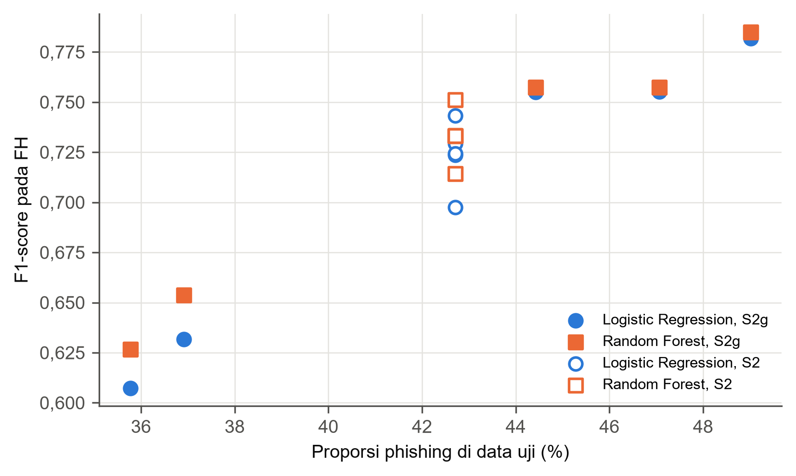

# Ketergantungan Model Deteksi URL Phishing pada Artefak Dataset: Evaluasi Fitur Berbasis Host dan Validasi Berbasis Domain Induk pada PhiUSIIL

# Dataset Artifacts in Phishing URL Detection: Evaluating Host-Based Features and Registered-Domain Validation on PhiUSIIL

**Hammam Hidayatullah¹, Dimas Reza Ardhana²**

¹ ² Program Studi Sarjana Terapan Teknik Informatika, Politeknik Elektronika Negeri Surabaya

Email: ¹hammamfais7@gmail.com, ²

Kelompok 9, Tata Tulis Karya Ilmiah, Topik P1

---

## Abstrak

Model deteksi URL phishing pada dataset PhiUSIIL umumnya melaporkan skor hampir sempurna. Audit kami menemukan bahwa seluruh 134.850 URL sah pada dataset ini mengikuti satu templat: skema https, host diawali `www.`, dan tanpa path. Pola yang hanya muncul pada 1,03% URL phishing ini sudah lebih dulu dilaporkan di sebuah repositori publik dengan satu model dan satu split, dan penelitian ini mengujinya secara terkendali. Kami membandingkan aturan templat tanpa pembelajaran mesin (R0) dengan empat set fitur: semua fitur bawaan (FL), fitur URL bawaan (FU), fitur host yang dihitung ulang tanpa templat (FH), dan FH ditambah tiga penanda templat (FHT). Setiap set diuji dengan Logistic Regression dan Random Forest pada *stratified random split* dan pada split berstrata yang memisahkan domain induk (eTLD+1), masing-masing dengan lima *seed*. Aturan R0 saja mencapai F1 99,49%. Tanpa templat, F1 turun 24,68–28,19 poin persentase (pp) dibandingkan FU (*paired t-test*, p < 0,0001). Menambahkan tiga penanda templat mengembalikan F1 ke 99,58–99,60%, hanya 0,36–0,40 pp di bawah FU yang memakai 22 fitur. Pemisahan per domain induk tidak mengubah F1 pada FL, FU, dan FHT. Penurunan kecil hanya terlihat pada FH dengan Random Forest (−2,02 pp; p = 0,022). Hasil ini mengindikasikan bahwa skor tinggi pada PhiUSIIL sebagian besar berasal dari artefak cara data dikumpulkan, bukan dari pola phishing yang dapat digeneralisasi.

**Kata kunci:** artefak dataset, deteksi URL phishing, kebocoran data, PhiUSIIL, *shortcut learning*, validasi berbasis domain

## Abstract

Phishing URL detectors evaluated on the PhiUSIIL dataset usually report near-perfect scores. Our audit found that all 134,850 legitimate URLs in this dataset share one template: the https scheme, a host that begins with `www.`, and no path. The pattern, which only 1.03% of phishing URLs follow, was first reported in a public repository that used one model and one split, and this study tests it under controlled conditions. We compare a template rule without machine learning (R0) with four feature sets: all built-in features (FL), built-in URL features (FU), host features recomputed without the template (FH), and FH plus three template flags (FHT). Each set is evaluated with Logistic Regression and Random Forest under a stratified random split and under a stratified split that separates registered domains (eTLD+1), each over five seeds. The R0 rule alone reaches an F1-score of 99.49%. Without the template, F1 drops by 24.68–28.19 percentage points (pp) relative to FU (paired t-test, p < 0.0001). Adding the three template flags restores F1 to 99.58–99.60%, only 0.36–0.40 pp below FU with 22 features. Registered-domain splitting does not change F1 for FL, FU, and FHT. A small drop appears only for FH with Random Forest (−2.02 pp; p = 0.022). These results indicate that high scores on PhiUSIIL largely reflect an artifact of how the data were collected rather than generalizable phishing patterns.

**Keywords:** data leakage, dataset artifacts, domain-aware validation, phishing URL detection, PhiUSIIL, shortcut learning

---

## 1. Pendahuluan

Daftar hitam (*blacklist*) hanya mengenali alamat yang sudah dilaporkan, sehingga klasifikasi URL berbasis pembelajaran mesin banyak dipakai sebagai pelengkap. Ma dkk. (2009) menunjukkan bahwa URL berbahaya dapat dikenali dari fitur leksikal dan fitur host tanpa membuka halamannya. Sahingoz dkk. (2019) juga membangun deteksi phishing yang hanya memakai URL. Dengan cara ini, prediksi dapat dibuat sebelum pengguna mengklik tautan.

PhiUSIIL (Prasad & Chandra, 2024a; Prasad, 2023) adalah salah satu dataset terbesar untuk tugas ini. Dokumentasinya menyebut 134.850 URL sah dan 100.945 URL phishing, dengan fitur yang diekstraksi dari URL dan kode sumber halaman (Prasad & Chandra, 2024b). Skor pada dataset ini sangat tinggi. Repositori acuan dari buku petunjuk mata kuliah melaporkan F1 1,0000 untuk Random Forest dengan *stratified random split* (pradhyumnaag30, 2025). Ahamed dkk. (2026) memakai split per host 70/15/15 dan tetap memperoleh akurasi uji 0,9962–0,9984 untuk empat model.

Skor setinggi itu perlu diperiksa, karena Arp dkk. (2022) mencatat dua jebakan yang relevan, yaitu *sampling bias* ketika data tidak mewakili distribusi masalah yang sebenarnya, dan *spurious correlation* ketika artefak yang tidak terkait masalah keamanan menjadi jalan pintas untuk memisahkan kelas. Geirhos dkk. (2020) menyebut jalan pintas seperti ini *shortcut*, yaitu aturan keputusan yang bekerja pada *benchmark* tetapi gagal pada kondisi uji yang lebih sulit. Masalah yang berdekatan adalah kebocoran data, saat model memperoleh informasi tentang target yang seharusnya tidak tersedia secara sah (Kaufman dkk., 2011), dan taksonomi Kapoor dan Narayanan (2023) memasukkan fitur yang menjadi proksi hasil (L2) serta ketidakbebasan antara sampel latih dan uji (L3.2) ke dalamnya. Untuk PhiUSIIL sendiri, Ahamed dkk. (2026) mengakui bahwa pemisahan per host tidak menjamin pemisahan per domain induk, karena 1.387 domain induk muncul di data latih maupun data uji mereka. Haider (2026), dalam repositori yang masih berstatus *work in progress*, melaporkan bahwa semua URL sah di PhiUSIIL berbentuk `https://www.domain.tld` tanpa path, serta mencatat akurasi 0,9958 untuk aturan regex dan 0,8647 untuk model netral-templat. Angka itu berasal dari satu split per host tanpa pengulangan dan tanpa uji statistik. Dua studi lain, Mia dkk. (2024) dan Yi dkk. (2026), menguji perpindahan antardataset, tetapi tidak memakai PhiUSIIL.

Penelitian ini merupakan replikasi kritis atas temuan templat tersebut dan menjawab dua pertanyaan, yaitu seberapa besar kinerja deteksi pada PhiUSIIL bergantung pada fitur yang mengikuti templat URL sah (RQ1), dan apakah pemisahan data per domain induk (eTLD+1) mengubah estimasi kinerja dibandingkan *stratified random split* (RQ2). Kami menduga kinerja turun jelas ketika model hanya memakai fitur host tanpa templat (H1), dan split per domain induk menurunkan kinerja, terutama pada fitur host tersebut (H2). Kontribusi penelitian ini adalah:

1. pengujian dua model pada lima *seed* dengan uji statistik berpasangan, bukan satu model pada satu split;
2. ablasi FHT yang menambahkan tiga penanda templat ke fitur host, untuk memisahkan efek templat dari efek jumlah fitur;
3. split berstrata berbasis domain induk (eTLD+1), yang lebih ketat daripada pemisahan per host pada studi sebelumnya;
4. analisis komposisi data uji pada split berbasis grup, yang menunjukkan pengaruh kelompok domain *hosting* besar terhadap estimasi kinerja.

## 2. Metode

Gambar 1 merangkum alur eksperimen. Semua angka pada bagian Hasil berasal dari berkas di folder `results/` pada repositori penelitian.

**Gambar 1.** Alur eksperimen, dari audit data sampai uji statistik.

### 2.1 Dataset dan prapemrosesan

Sumber data adalah dataset Kaggle versi 1 (KagglePro, 2024) dengan lisensi CC BY-SA 4.0. Dataset aslinya diterbitkan di Mendeley Data dengan lisensi CC BY 4.0 (Prasad, 2023). Berkas yang kami pakai berukuran 56.854.345 byte, sama dengan berkas di Kaggle, dan hash SHA-256-nya sama dengan berkas `Dataset.csv` pada repositori acuan. Audit menemukan 235.795 baris, 56 kolom, tanpa nilai kosong, dan tanpa baris yang duplikat penuh. Ringkasan audit ada di Lampiran A.

Ada 425 URL yang masing-masing muncul dua kali. Semuanya berlabel phishing tanpa konflik label, dan duplikatnya dihapus sebelum data dibagi, sehingga tersisa 235.370 URL. Label dibalik sehingga phishing menjadi kelas positif. Kolom `FILENAME`, `URL`, `Domain`, `TLD`, dan `Title` tidak dipakai sebagai fitur; `FILENAME` bahkan membocorkan label, karena 36.286 nama berawalan `mw` seluruhnya phishing. Dua kolom di antaranya, `URL` dan `Domain`, hanya dipakai untuk menghitung FH, penanda templat, dan grup split. Standardisasi untuk Logistic Regression berada di dalam `Pipeline`, sehingga hanya dipelajari dari data latih. Tidak ada penyetelan hiperparameter, jadi tidak ada set validasi.

### 2.2 Set fitur

**Tabel 1.** Set fitur

| Kode | Isi | Jumlah fitur |
|---|---|---|
| R0 | Aturan tanpa pelatihan: URL diprediksi sah bila cocok dengan `^https://www\.[^/?#]+/?$` dan phishing bila tidak cocok | 0 |
| FL | Semua fitur numerik bawaan (fitur URL dan fitur isi halaman) | 50 |
| FU | Fitur URL bawaan dataset (panjang, jumlah dan rasio karakter, obfuskasi, IP, https, serta `TLDLegitimateProb`, `URLCharProb`, `URLSimilarityIndex`); daftar lengkap di README repositori | 22 |
| FH | Fitur host yang dihitung ulang dari hostname setelah `www.` dan port dibuang: panjang, jumlah label, angka, rasio angka, tanda hubung, huruf, label terpanjang, panjang suffix publik, penanda IP, entropi Shannon | 10 |
| FHT | FH ditambah tiga penanda templat dari URL: `is_https`, `starts_www`, `no_path_query` | 13 |

FU sengaja tetap memuat `URLSimilarityIndex`, `TLDLegitimateProb`, dan `URLCharProb`, karena ketiganya tidak memerlukan isi halaman. Pertanyaan kami adalah seberapa jauh fitur bawaan seperti ini membawa templat, sehingga FH dan FHT dipakai sebagai kontrol. FH tidak dapat melihat skema, `www.`, path, maupun query, sedangkan FHT hanya mengembalikan informasi itu. Kalau FHT mendekati FU sementara FH jauh di bawahnya, penurunan FH tidak disebabkan oleh jumlah fitur yang lebih sedikit.

### 2.3 Strategi split

Ketiga strategi memakai rasio 70/30 dan lima *seed*: 7, 21, 42, 123, dan 2026. **S1** adalah *stratified random split*, sama dengan protokol repositori acuan. **S2** memakai `StratifiedGroupKFold` dengan 10 fold dan grup berupa domain induk; tiga fold dipilih acak per *seed* sebagai data uji. Pemilihan acak diperlukan karena algoritma ini selalu menaruh grup terbesar di fold-fold awal. **S2g**, rancangan awal S2, memakai `GroupShuffleSplit` dengan grup yang sama tanpa menjaga proporsi kelas, sehingga kami pakai sebagai analisis sensitivitas.

Domain induk dihitung dengan `tldextract` 5.4.0 secara luring, memakai salinan *Public Suffix List* bawaannya dan hanya bagian ICANN. Dengan pilihan ini, `a.web.app` dan `b.web.app` masuk grup `web.app`. Bila bagian *private* dipakai, setiap subdomain `web.app` menjadi grup sendiri dan split akan kembali mendekati pemisahan per hostname, padahal hampir setiap hostname hanya muncul sekali (220.086 hostname dari 235.795 URL). Pada S1, 3.491–3.548 domain induk muncul di data latih dan uji sekaligus; pada S2 dan S2g jumlahnya 0.

### 2.4 Model, metrik, dan uji statistik

Logistic Regression memakai `StandardScaler` dan `LogisticRegression(max_iter=1000)`. Random Forest (Breiman, 2001) memakai 100 pohon. Hiperparameter lain memakai nilai bawaan scikit-learn, dengan `random_state` sama dengan *seed*. Ada 120 run (4 set fitur × 3 split × 2 model × 5 *seed*), dan R0 dievaluasi pada data uji yang sama.

Kami melaporkan precision, recall, F1, ROC-AUC, PR-AUC, jumlah *false negative* (FN, phishing yang lolos), *false positive* (FP), dan waktu. Setiap efek dihitung per *seed* sebagai selisih F1 dalam poin persentase (pp), lalu diuji dengan *paired t-test* dua sisi dan IK 95%. Uji Wilcoxon *signed-rank* dipakai sebagai pembanding; dengan n = 5, nilai p terkecilnya adalah 0,0625. Selisih ROC-AUC juga diuji karena tidak bergantung pada proporsi kelas.

### 2.5 Lingkungan dan reproduksi baseline

Eksperimen berjalan di Windows 11 dengan Python 3.14.0, pandas 3.1.1, NumPy 2.5.5, scikit-learn 1.9.1 (Pedregosa dkk., 2011), SciPy 1.18.1, tldextract 5.4.0, dan matplotlib 3.11.2. Protokol baseline mengikuti repositori pradhyumnaag30 (2025), commit `4b4d6ae`. Repositori itu tidak berlisensi, sehingga notebook mereka hanya dijalankan apa adanya di luar repositori kami, lalu protokolnya ditulis ulang: label sah sebagai kelas positif, tanpa penghapusan duplikat, dan Random Forest 200 pohon.

## 3. Hasil

### 3.1 Templat URL sah

Tabel 2 menunjukkan bahwa seluruh URL sah memakai https, diawali `www.`, tidak memiliki path atau query, dan memiliki `URLSimilarityIndex` = 100. Hanya 1.038 URL phishing (1,03%) yang cocok persis dengan aturan R0. ROC-AUC satu fitur tertinggi dicapai `URLSimilarityIndex` (0,9961), lalu `LineOfCode` (0,9903) dan `NoOfExternalRef` (0,9880).

**Tabel 2.** Ciri templat URL per label (CSV asli)

| Ciri | Sah (n = 134.850) | Phishing (n = 100.945) |
|---|---|---|
| Skema https | 134.850 (100,00%) | 49.196 (48,74%) |
| Host diawali `www.` | 134.850 (100,00%) | 41.746 (41,36%) |
| Tanpa path, query, fragmen | 134.850 (100,00%) | 72.272 (71,60%) |
| `URLSimilarityIndex` = 100 | 134.850 (100,00%) | 786 (0,78%) |
| Cocok persis dengan aturan R0 | 134.850 (100,00%) | 1.038 (1,03%) |

### 3.2 Reproduksi baseline

Dengan protokol repositori acuan dan *seed* 42, kode kami menghasilkan F1 0,999913 (LR) dan 1,000000 (RF), sama dengan README repositori tersebut. Notebook asli yang dijalankan ulang memberi 0,999913 dan 0,999988. Selisih pada RF diduga muncul karena model mereka tidak memakai `random_state`.

### 3.3 Kinerja per skenario

Tabel 3 dan Gambar 2 merangkum kinerja pada S1 dan S2, dengan 70.611 URL uji pada setiap run. R0 mencapai F1 99,49% (S1) dan 99,51% (S2) tanpa FP. FL dan FU berada di 99,95–100,00%. FH turun menjadi 71,78% (LR) dan 75,31% (RF) pada S1, terutama karena recall hanya 59,25% dan 64,93%. Rata-rata FN pada FH adalah 10.576–12.288 per run, dibandingkan 1–19 pada FL dan FU. FHT mengembalikan F1 menjadi 99,58–99,60%.

**Tabel 3.** Kinerja rata-rata ± simpangan baku pada 5 *seed* (F1, recall, dan ROC-AUC dalam %)

| Split | Fitur | Model | F1 | Recall | ROC-AUC | FN | FP |
|---|---|---|---|---|---|---|---|
| S1 | R0 | aturan | 99,49 ± 0,01 | 98,98 ± 0,02 | 99,49 ± 0,01 | 307,6 ± 6,0 | 0,0 ± 0,0 |
| S1 | FL | LR | 99,99 ± 0,00 | 99,97 ± 0,01 | 100,00 ± 0,00 | 7,8 ± 2,7 | 0,0 ± 0,0 |
| S1 | FL | RF | 100,00 ± 0,00 | 100,00 ± 0,00 | 100,00 ± 0,00 | 1,0 ± 1,2 | 0,0 ± 0,0 |
| S1 | FU | LR | 99,97 ± 0,01 | 99,94 ± 0,02 | 99,99 ± 0,00 | 19,4 ± 5,3 | 0,0 ± 0,0 |
| S1 | FU | RF | 99,99 ± 0,00 | 99,98 ± 0,01 | 99,99 ± 0,00 | 6,2 ± 2,2 | 0,4 ± 0,5 |
| S1 | FH | LR | 71,78 ± 0,09 | 59,25 ± 0,07 | 82,34 ± 0,12 | 12.287,8 ± 21,4 | 1.762,4 ± 38,6 |
| S1 | FH | RF | 75,31 ± 0,18 | 64,93 ± 0,22 | 84,92 ± 0,13 | 10.576,0 ± 66,3 | 2.260,8 ± 25,1 |
| S1 | FHT | LR | 99,58 ± 0,02 | 99,20 ± 0,04 | 99,76 ± 0,02 | 241,6 ± 12,8 | 10,8 ± 4,1 |
| S1 | FHT | RF | 99,60 ± 0,01 | 99,29 ± 0,04 | 99,71 ± 0,02 | 215,4 ± 11,3 | 26,8 ± 3,6 |
| S2 | R0 | aturan | 99,51 ± 0,06 | 99,03 ± 0,12 | 99,51 ± 0,06 | 292,6 ± 36,1 | 0,0 ± 0,0 |
| S2 | FL | LR | 99,98 ± 0,00 | 99,97 ± 0,01 | 100,00 ± 0,00 | 9,2 ± 2,8 | 0,0 ± 0,0 |
| S2 | FL | RF | 100,00 ± 0,00 | 100,00 ± 0,00 | 100,00 ± 0,00 | 0,4 ± 0,9 | 0,0 ± 0,0 |
| S2 | FU | LR | 99,95 ± 0,03 | 99,89 ± 0,06 | 99,99 ± 0,01 | 33,0 ± 18,4 | 0,0 ± 0,0 |
| S2 | FU | RF | 99,99 ± 0,00 | 99,98 ± 0,00 | 99,99 ± 0,00 | 5,6 ± 0,5 | 0,8 ± 0,8 |
| S2 | FH | LR | 72,36 ± 1,66 | 59,95 ± 2,17 | 82,54 ± 0,97 | 12.077,0 ± 653,7 | 1.722,8 ± 28,3 |
| S2 | FH | RF | 73,30 ± 1,30 | 62,17 ± 1,82 | 83,96 ± 0,57 | 11.406,6 ± 548,2 | 2.246,6 ± 80,6 |
| S2 | FHT | LR | 99,59 ± 0,05 | 99,22 ± 0,11 | 99,76 ± 0,04 | 235,8 ± 33,0 | 12,0 ± 3,2 |
| S2 | FHT | RF | 99,59 ± 0,05 | 99,28 ± 0,10 | 99,71 ± 0,04 | 216,0 ± 29,6 | 28,8 ± 3,3 |

**Gambar 2.** F1 (atas) dan jumlah FN dalam skala log (bawah) per set fitur, untuk S1 (kiri) dan S2 (kanan). Titik adalah rata-rata lima *seed*, garis adalah ±1 simpangan baku, dan FN bernilai 0 digambar pada 0,5.

Waktu latih pada S1 adalah 0,15–0,27 detik untuk LR dan 0,79–1,05 detik untuk RF. Inferensi membutuhkan 0,10–1,00 milidetik per 1.000 URL, sementara R0 membutuhkan 0,37 milidetik.

### 3.4 Efek set fitur dan split

Tabel 4 memuat selisih F1 per *seed*. FH lebih rendah daripada FU sebesar 24,68–28,19 pp, dan FHT lebih tinggi daripada FH sebesar 24,28–27,80 pp (semua p < 0,0001). FHT berada 0,36–0,40 pp di bawah FU. Selisih FU terhadap FL hanya −0,01 sampai −0,04 pp. Pada semua perbandingan antar set fitur, kelima *seed* bertanda sama (Wilcoxon p = 0,0625).

Selisih S2 − S1 pada FL, FU, dan FHT berada di antara −0,02 dan 0,01 pp (p = 0,14–0,83). Pada FH, selisihnya 0,58 pp untuk LR (IK 95% [−1,47; 2,63]; p = 0,48) dan −2,02 pp untuk RF (IK 95% [−3,55; −0,48]; p = 0,022), dengan kelima *seed* RF negatif. Selisih ROC-AUC searah: 0,20 pp untuk LR (p = 0,65) dan −0,96 pp untuk RF (p = 0,023).

**Tabel 4.** Selisih F1 per *seed* dalam pp (rata-rata dan IK 95%)

| Efek | Model | S1 | p (S1) | S2 | p (S2) |
|---|---|---|---|---|---|
| FH − FU | LR | −28,19 [−28,30; −28,08] | < 0,0001 | −27,59 [−29,61; −25,56] | < 0,0001 |
| FH − FU | RF | −24,68 [−24,90; −24,46] | < 0,0001 | −26,69 [−28,31; −25,07] | < 0,0001 |
| FHT − FH | LR | 27,80 [27,67; 27,93] | < 0,0001 | 27,23 [25,22; 29,23] | < 0,0001 |
| FHT − FH | RF | 24,28 [24,06; 24,50] | < 0,0001 | 26,30 [24,72; 27,87] | < 0,0001 |
| FHT − FU | LR | −0,39 [−0,42; −0,36] | < 0,0001 | −0,36 [−0,41; −0,31] | < 0,0001 |
| FHT − FU | RF | −0,39 [−0,41; −0,37] | < 0,0001 | −0,40 [−0,46; −0,34] | < 0,0001 |
| FU − FL | LR | −0,02 [−0,03; −0,01] | 0,0058 | −0,040 [−0,076; −0,003] | 0,0392 |
| FU − FL | RF | −0,01 [−0,01; −0,01] | 0,0030 | −0,01 [−0,01; −0,01] | 0,0007 |

### 3.5 Analisis sensitivitas: S2g dan komposisi data uji

Porsi data uji pada S2g berkisar 26,8–33,5% dan proporsi phishing di data uji 35,77–49,02%, padahal pada S1 dan S2 keduanya selalu 30,0% dan 42,71%. Simpangan baku F1 pada FH di S2g mencapai 8,03 pp (LR) dan 7,08 pp (RF), dibandingkan 1,66 dan 1,30 pp di S2. Selisih S2g − S1 pada FH adalah −1,16 pp (LR; p = 0,76) dan −3,71 pp (RF; p = 0,30). F1 pada FH di S2g berkorelasi r = 0,98 dengan proporsi phishing di data uji (Gambar 3). Ketika hanya satu dari sepuluh domain induk terbesar masuk data uji, seperti pada *seed* 42 dan 2026, F1 pada FH hanya 60,74–65,37%. Sebaliknya, *seed* 123 menempatkan lima domain itu di data uji (17.318 baris), dan F1 mencapai 78,18–78,50%. Pada S2, ketika proporsi kelas sudah sama, F1 pada FH tetap berkorelasi dengan jumlah baris dari sepuluh domain terbesar di data uji (r = 0,97 untuk LR; r = 0,9995 untuk RF; n = 5).

**Gambar 3.** F1 pada FH terhadap proporsi phishing di data uji untuk S2g (penanda penuh) dan S2 (penanda kosong). Setiap titik adalah satu *seed*.

## 4. Pembahasan

### 4.1 Templat sebagai jalan pintas

Hasil RQ1 mendukung H1. Aturan satu baris sudah mencapai F1 99,49%, sehingga sebagian besar pemisahan kelas dapat dicapai hanya dari bentuk URL. Ketika skema, `www.`, dan path disembunyikan (FH), F1 turun sekitar 25–28 pp, lalu kembali ke 99,6% begitu tiga penanda itu dikembalikan (FHT). Dengan demikian, penurunan pada FH tidak dapat dijelaskan oleh jumlah fitur yang lebih sedikit. Pola ini sesuai dengan *spurious correlation* menurut Arp dkk. (2022). Menurut taksonomi Kapoor dan Narayanan (2023), fitur seperti `URLSimilarityIndex` yang bernilai 100 pada semua URL sah bekerja sebagai proksi label (L2).

Asal templat ini belum dapat kami pastikan. Dokumentasi dataset di UCI Machine Learning Repository (Prasad & Chandra, 2024b) tidak menjelaskan cara URL sah dikumpulkan. Dugaan kami, URL sah diambil dari daftar domain populer dan dibentuk menjadi alamat halaman depan, sedangkan URL phishing diambil apa adanya dari laporan phishing. Penjelasan ini sejalan dengan *sampling bias* (Arp dkk., 2022), tetapi penelitian ini tidak mengujinya.

### 4.2 Perbandingan dengan studi sebelumnya

Temuan templat, aturan regex, dan model netral-templat sudah dilaporkan lebih dulu oleh Haider (2026), dengan akurasi 0,9958 dan 0,8647 dari satu split per host. Hasil kami searah dan menambah pengulangan pada dua model dan lima *seed* dengan IK 95%, ablasi FHT, serta split per domain induk. Akurasi 0,9962–0,9984 pada Ahamed dkk. (2026) bisa jadi juga dipengaruhi templat, karena split per host tidak mengubah bentuk URL. Kami tidak menguji model mereka secara langsung, sehingga dugaan ini masih perlu diperiksa dengan mengulang protokol mereka tanpa informasi templat. Mia dkk. (2024) menemukan akurasi turun ke 51% ketika model diuji pada dataset lain. Temuan kami memberi satu penjelasan yang mungkin untuk gejala seperti itu: pola yang dipelajari bisa melekat pada cara satu dataset disusun.

### 4.3 Validasi per domain induk

Hasil RQ2 hanya mendukung H2 sebagian. Pada FL, FU, dan FHT, split per domain induk tidak mengubah F1, karena templat tetap tersedia di data uji apa pun cara datanya dibagi. Penurunan 2,02 pp hanya muncul pada FH dengan Random Forest, ketika model harus bergantung pada ciri host. Salah satu penjelasannya adalah hilangnya domain induk yang sama di kedua sisi split. Logistic Regression tidak menunjukkan penurunan, barangkali karena model linear dengan 10 fitur host tidak cukup lentur untuk menghafal ciri grup domain, meskipun dugaan ini belum kami uji.

Split S2g memperlihatkan bahwa pembagian berbasis grup tanpa stratifikasi dapat menghasilkan estimasi yang sangat bervariasi. Sepuluh domain induk terbesar, seperti `web.app`, `firebaseapp.com`, dan `repl.co`, seluruhnya berisi phishing dan masing-masing memuat ratusan sampai ribuan URL. Penempatan beberapa grup itu menentukan komposisi data uji dan sebagian besar nilai F1 pada FH. Korelasi yang tetap tinggi pada S2 memberi petunjuk bahwa jenis grup yang masuk data uji ikut berpengaruh, bukan hanya proporsi kelasnya. Karena hanya berdasarkan lima *seed*, koefisien korelasi ini kurang stabil. Penelitian yang memakai split per domain pada PhiUSIIL sebaiknya memakai stratifikasi dan melaporkan komposisi data uji per *seed*.

### 4.4 Implikasi dan keterbatasan

Skor F1 di atas 99% pada PhiUSIIL tidak cukup untuk menilai kemampuan model pada URL baru. Dalam penggunaan nyata, URL sah juga memiliki path, query, dan subdomain lain di luar `www`, sehingga model yang bergantung pada templat berisiko menandai URL seperti itu sebagai phishing. Tanpa templat, fitur host saja memberi recall 59–65%, artinya sekitar 35–41% URL phishing lolos.

Penelitian ini memiliki beberapa keterbatasan. Ringkasan ancaman validitas ada di Lampiran B.

1. Hanya satu dataset yang diuji, tanpa validasi temporal, sehingga generalisasi ke data lain belum diketahui.
2. Model memakai hiperparameter bawaan; penyetelan dapat mengubah besar efek.
3. Hasil FH bergantung pada daftar fitur host yang kami pilih.
4. Dengan lima *seed*, daya uji Wilcoxon dan stabilitas korelasi terbatas. Pembagian S1 dan S2 juga berbeda meskipun *seed* sama, sehingga uji berpasangan bersifat pendekatan.
5. Waktu inferensi tidak mencakup ekstraksi fitur.
6. Domain induk dihitung dari salinan *Public Suffix List* bawaan `tldextract` 5.4.0, bukan versi terbaru.

## 5. Kesimpulan

Untuk RQ1, kinerja deteksi pada PhiUSIIL sangat bergantung pada templat URL sah. Aturan templat tanpa pembelajaran mesin mencapai F1 99,49%. Menyembunyikan templat menurunkan F1 sebesar 24,68–28,19 pp, dan mengembalikan tiga penanda templat memulihkannya hingga 0,36–0,40 pp di bawah fitur URL bawaan. Untuk RQ2, split per domain induk tidak mengubah F1 selama templat tersedia. Penurunan 2,02 pp hanya terlihat pada fitur host dengan Random Forest. Split berbasis grup tanpa stratifikasi membuat estimasi sangat bergantung pada penempatan domain *hosting* besar.

Kami menyarankan tiga langkah terukur. Pertama, laporkan kinerja R0 sebagai baseline setiap kali PhiUSIIL dipakai. Kedua, uji ulang protokol Ahamed dkk. (2026) dengan URL yang dinormalisasi tanpa skema, `www.`, dan path. Ketiga, uji model yang dilatih pada PhiUSIIL terhadap URL sah yang memiliki path dan subdomain, serta pada dataset lain dengan split per domain induk berstrata dan validasi temporal.

## Pernyataan Ketersediaan Data dan Kode

Kode, notebook, hasil per run, laporan split, uji statistik, matriks literatur, dan gambar tersedia di https://github.com/HammamFais/ttki-p1-phishing-shortcut (tag `v1.0-final`) dengan lisensi MIT. Nama set fitur di paper (FL, FU, FH, FHT) sama dengan F1, F2, F3, F4 di kode dan CSV. Dataset tidak disertakan, tetapi dapat diunduh dari Kaggle (KagglePro, 2024), dan berkas `data/README.md` mencatat ukuran, hash SHA-256, dan lisensinya.

## Daftar Pustaka

Ahamed, T., Kakon, S. C., Al Farid, F., Uddin, J., & Abdul Karim, H. B. (2026). An integrated evaluation protocol for adversarial robustness, generalization, and explanation stability in URL-based phishing detection. *Frontiers in Computer Science, 8*, Artikel 1834407. https://doi.org/10.3389/fcomp.2026.1834407

Arp, D., Quiring, E., Pendlebury, F., Warnecke, A., Pierazzi, F., Wressnegger, C., Cavallaro, L., & Rieck, K. (2022). Dos and don'ts of machine learning in computer security. Dalam *Proceedings of the 31st USENIX Security Symposium* (hlm. 3971–3988). USENIX Association. https://www.usenix.org/conference/usenixsecurity22/presentation/arp

Breiman, L. (2001). Random forests. *Machine Learning, 45*(1), 5–32. https://doi.org/10.1023/A:1010933404324

Geirhos, R., Jacobsen, J.-H., Michaelis, C., Zemel, R., Brendel, W., Bethge, M., & Wichmann, F. A. (2020). Shortcut learning in deep neural networks. *Nature Machine Intelligence, 2*(11), 665–673. https://doi.org/10.1038/s42256-020-00257-z

Haider, M. (2026). *Robustness-or-Artifact* [Repositori GitHub]. GitHub. https://github.com/mutwassim/Robustness-or-Artifact

KagglePro. (2024). *Phishing URL - Websites Dataset (PhiUSIIL)* (Versi 1) [Set data]. Kaggle. https://www.kaggle.com/datasets/kaggleprollc/phishing-url-websites-dataset-phiusiil

Kapoor, S., & Narayanan, A. (2023). Leakage and the reproducibility crisis in machine-learning-based science. *Patterns, 4*(9), Artikel 100804. https://doi.org/10.1016/j.patter.2023.100804

Kaufman, S., Rosset, S., & Perlich, C. (2011). Leakage in data mining: Formulation, detection, and avoidance. Dalam *Proceedings of the 17th ACM SIGKDD International Conference on Knowledge Discovery and Data Mining* (hlm. 556–563). ACM. https://doi.org/10.1145/2020408.2020496

Ma, J., Saul, L. K., Savage, S., & Voelker, G. M. (2009). Beyond blacklists: Learning to detect malicious web sites from suspicious URLs. Dalam *Proceedings of the 15th ACM SIGKDD International Conference on Knowledge Discovery and Data Mining* (hlm. 1245–1254). ACM. https://doi.org/10.1145/1557019.1557153

Mia, M., Derakhshan, D., & Pritom, M. M. A. (2024). Can features for phishing URL detection be trusted across diverse datasets? A case study with explainable AI. Dalam *Proceedings of the 11th International Conference on Networking, Systems, and Security* (hlm. 137–145). ACM. https://doi.org/10.1145/3704522.3704532

Pedregosa, F., Varoquaux, G., Gramfort, A., Michel, V., Thirion, B., Grisel, O., Blondel, M., Prettenhofer, P., Weiss, R., Dubourg, V., Vanderplas, J., Passos, A., Cournapeau, D., Brucher, M., Perrot, M., & Duchesnay, É. (2011). Scikit-learn: Machine learning in Python. *Journal of Machine Learning Research, 12*, 2825–2830. https://jmlr.org/papers/v12/pedregosa11a.html

pradhyumnaag30. (2025). *PhiUSIIL-Phishing-URL-Detection* [Repositori GitHub]. GitHub. https://github.com/pradhyumnaag30/PhiUSIIL-Phishing-URL-Detection

Prasad, A. (2023). *PhiUSIIL phishing URL dataset* (Versi 2) [Set data]. Mendeley Data. https://doi.org/10.17632/shwpxscxy2.2

Prasad, A., & Chandra, S. (2024a). PhiUSIIL: A diverse security profile empowered phishing URL detection framework based on similarity index and incremental learning. *Computers & Security, 136*, Artikel 103545. https://doi.org/10.1016/j.cose.2023.103545

Prasad, A., & Chandra, S. (2024b). *PhiUSIIL Phishing URL (Website)* [Dataset]. UCI Machine Learning Repository. https://archive.ics.uci.edu/dataset/967/phiusiil+phishing+url+dataset

Sahingoz, O. K., Buber, E., Demir, O., & Diri, B. (2019). Machine learning based phishing detection from URLs. *Expert Systems with Applications, 117*, 345–357. https://doi.org/10.1016/j.eswa.2018.09.029

Yi, L., Omotosho, A., & Balogun, H. (2026). Phishing URL detection and interpretability with machine learning: A cross-dataset approach. *Security and Privacy, 9*(1), Artikel e70175. https://doi.org/10.1002/spy2.70175

---

## Lampiran A. Karakteristik dataset

| Butir | Nilai |
|---|---|
| Baris pada CSV asli | 235.795 |
| Kolom | 56 |
| Nilai kosong / tak hingga / baris duplikat penuh | 0 / 0 / 0 |
| Label asli: sah (1) / phishing (0) | 134.850 / 100.945 |
| URL duplikat yang dihapus (semuanya phishing, tanpa konflik label) | 425 |
| Baris setelah penghapusan duplikat: sah / phishing | 134.850 / 100.520 |
| Fitur numerik bawaan | 50 |
| Baris dengan `FILENAME` berawalan `mw` (semuanya phishing) | 36.286 |
| Hostname unik | 220.086 |
| Domain induk (eTLD+1) unik | 175.513 |
| Domain induk yang muncul lebih dari sekali / jumlah barisnya | 6.012 / 66.294 |
| Domain induk dengan label campuran | 120 |

## Lampiran B. Ancaman validitas

| Jenis | Ancaman | Penanganan dan sisa risiko |
|---|---|---|
| Internal | Duplikat URL bocor ke data latih dan uji | 425 duplikat dihapus sebelum split |
| Internal | Standardisasi memakai informasi data uji | Scaler berada di dalam `Pipeline` dan hanya dilatih pada data latih |
| Internal | Pasangan per *seed* antara S1 dan S2 tidak identik | Pembagian berbeda meskipun *seed* sama, sehingga uji berpasangan bersifat pendekatan |
| Konstruk | FH mungkin masih membawa jejak templat, atau justru membuang informasi host yang sah | Daftar fitur FH eksplisit; FHT dipakai sebagai kontrol |
| Konstruk | Waktu inferensi tidak termasuk ekstraksi fitur | Dilaporkan terpisah; perbandingan waktu antar set fitur tidak lengkap |
| Kesimpulan | n = 5 *seed* membatasi daya uji Wilcoxon dan stabilitas korelasi | IK 95% dan uji t dilaporkan; nilai p Wilcoxon minimum disebut |
| Eksternal | Satu dataset, satu waktu pengumpulan | Generalisasi ke dataset lain dan validasi temporal belum diuji |
| Eksternal | Asal templat tidak dapat diverifikasi dari dokumentasi publik | Ditulis sebagai dugaan |
